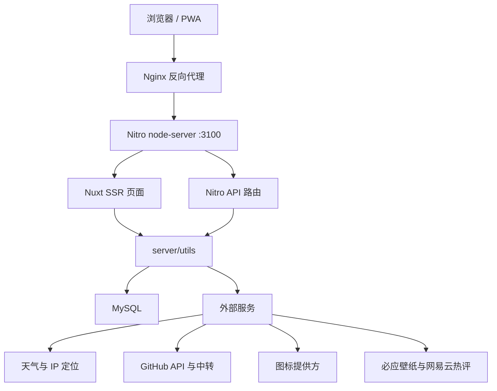
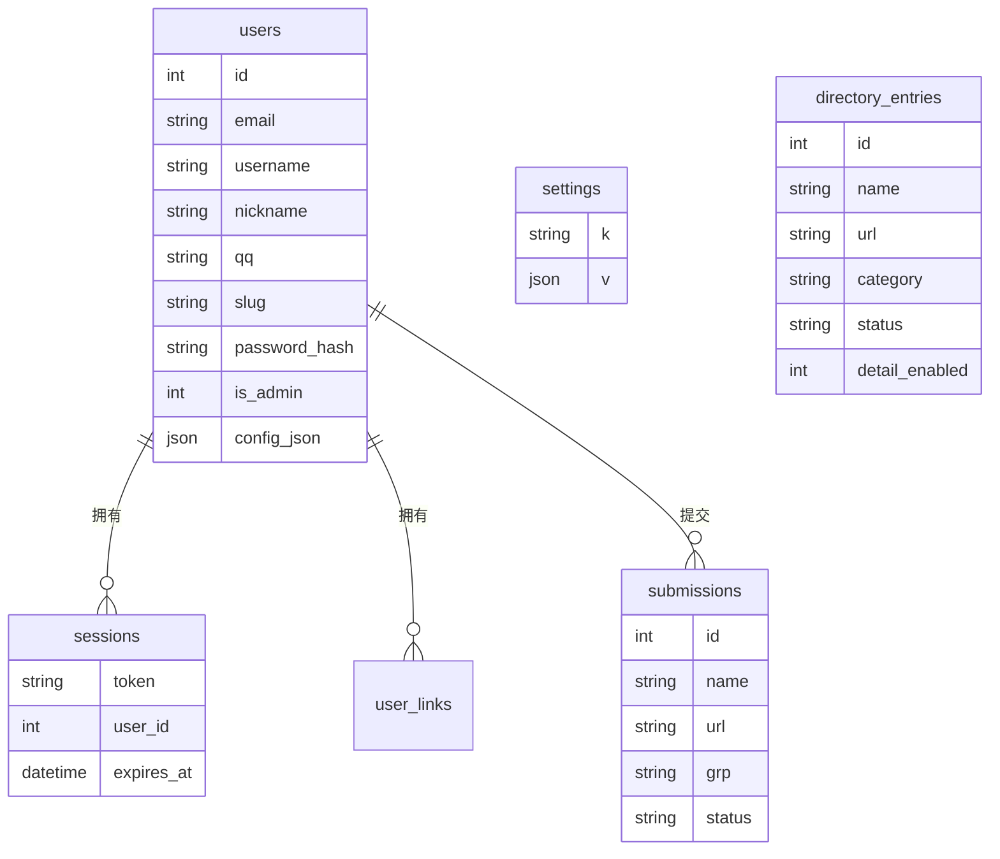
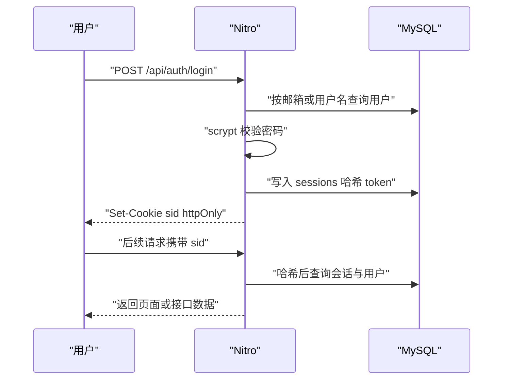
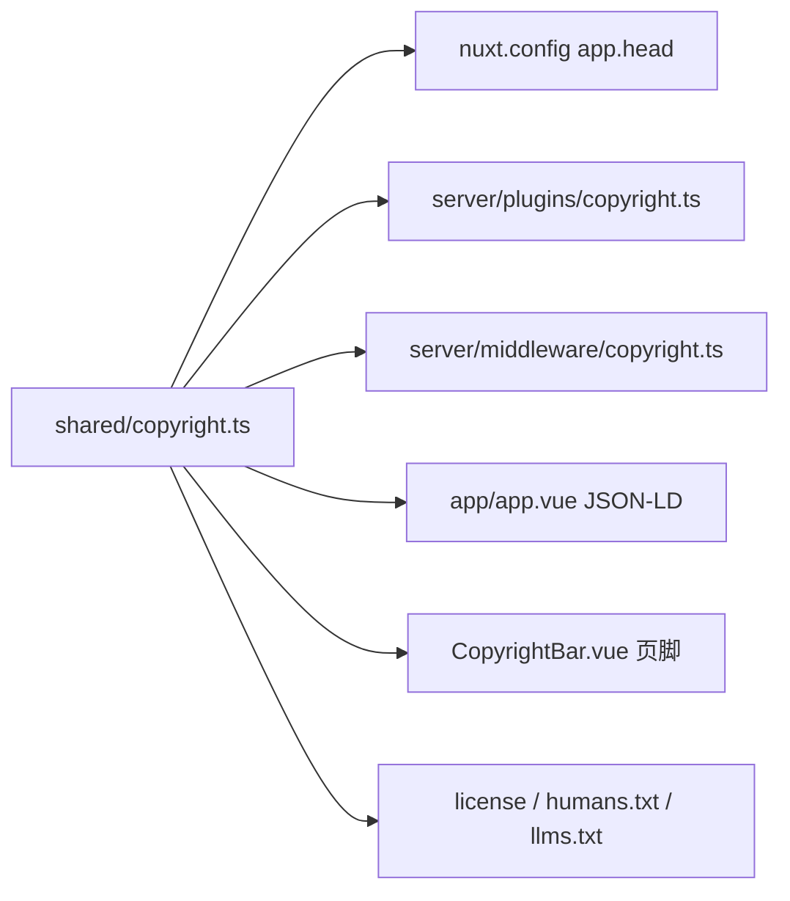

# 架构说明

本文说明 2077 导航的整体结构、核心模块、数据模型、缓存与安全设计。

## 1. 总体结构

生产环境通常由 PM2 以 cluster 模式运行两个 Nitro 实例，Nginx 轮询转发。会话与配置存放在 MySQL，实例之间可以水平扩展。

## 2. 前端分层

| 层 | 位置 | 职责 |
| --- | --- | --- |
| 页面 | `app/pages/` | 路由、SSR 数据获取、页面级 SEO |
| 布局 | `app/layouts/` | 前台与后台框架、页脚、版权栏 |
| 组件 | `app/components/` | 可复用 UI |
| 组合式状态 | `app/composables/` | 导航、认证、设备、壁纸、设置、天气 |
| 插件 | `app/plugins/` | 客户端行为，如图片淡入、版权全局对象 |
| 样式 | `app/assets/css/` | Tailwind 与设计令牌 |

页面通过 `useFetch` 获取公开接口，客户端交互通过 composable 管理。导航数据同时存在本地存储和云端配置中，登录后按用户同步。

## 3. 服务端分层

| 层 | 位置 | 职责 |
| --- | --- | --- |
| API 路由 | `server/api/` | 参数校验、鉴权、限流、响应 |
| 中间件 | `server/middleware/` | 安全头、访问统计、版权响应头 |
| 插件 | `server/plugins/` | CSP、版权注释、巡检、内存守卫、GitHub 预热 |
| 工具 | `server/utils/` | 数据库、认证、抓取、缓存、设置、SEO |
| 非 API 路由 | `server/routes/` | `llms.txt` 等文本入口 |
| 迁移 | `server/database/migrations/` | 增量数据库结构 |

API 文件使用 Nitro 文件路由。所有数据库访问通过 `useDb()` 连接池，所有需要管理员的接口调用 `requireAdmin()`。

## 4. 数据模型

- `users.config_json` 保存用户的云端导航配置。
- `settings` 是通用键值表，站点设置、导航配置、分类、友情链接都存放在这里。
- `directory_entries` 与首页导航是两套数据池，同一网址可以同时存在于两处。
- `schema_migrations` 记录已执行的迁移文件。

## 5. 缓存设计

| 缓存 | 位置 | 失效方式 |
| --- | --- | --- |
| 站点设置 | 进程内 5 秒 | TTL 或重载进程 |
| 首页导航配置 | 进程内 5 秒 | TTL 或重载进程 |
| 目录列表 | 进程内 + 数据库版本号 | 写入后更新 `directory_cache_version` |
| 图标 | 进程内 Map + `data/icons/` | 7 天 TTL |
| TDK 抓取 | `meta_cache` 表 | 7 天 TTL 或后台重新抓取 |
| 天气 | 进程内 | 30 分钟 TTL |
| GitHub 仓库与 README | 进程内 | 设置项中的 TTL |
| 页面 | Nitro route rules | `/sitemap` 600 秒、`/site` 120 秒、`/site/**` 300 秒 |

多实例部署时，进程内缓存各自独立。后台写操作需要让其他实例尽快看到变化，因此项目使用较短 TTL 或数据库版本号。

## 6. 认证与安全

### 认证

- 密码使用 `scrypt`，未知账号也会执行等价开销校验，降低时间侧信道。
- 会话 token 随机生成，数据库只存 SHA-256 哈希。
- Cookie 使用 `httpOnly`、`sameSite=lax`，生产环境启用 `secure`。
- 后台权限同时由路由中间件和服务端 `requireAdmin` 校验。

### 防护

| 风险 | 措施 |
| --- | --- |
| XSS | Vue 默认转义、Markdown 清洗、`sanitize-html` |
| SSRF | 提交与抓取限制 http/https、禁止私网与本地地址、限制端口 |
| 暴力登录 | 账号与 IP 双维度限流、等价开销校验 |
| 垃圾提交 | 请求体上限、蜜罐字段、限流、人工审核 |
| 点击劫持 | `X-Frame-Options: DENY`、CSP `frame-ancestors` |
| MIME 嗅探 | `X-Content-Type-Options: nosniff` |
| 跨站信息泄漏 | `Referrer-Policy`、`Permissions-Policy`、COOP |
| SQL 注入 | 参数化查询 |

安全响应头集中在 `server/middleware/security.ts`，CSP 由 `server/plugins/csp.ts` 根据实际内联脚本计算哈希。

## 7. PWA 与离线

- `@vite-pwa/nuxt` 生成 Service Worker。
- 导航请求使用 `NetworkFirst`，网络失败时回退 `/offline`。
- 不设置全局 `navigateFallback`，避免在线时误显示离线页。
- `public/sw-heal.js` 在新 Service Worker 激活后修复停留在离线页的窗口。
- 图标与部分公开接口使用 `CacheFirst` 或 `NetworkFirst`。

## 8. SEO 与内容发现

- 动态 XML sitemap 来源于 `/api/__sitemap__/urls`，包含分类页与已发布详情页。
- HTML 站点地图 `/sitemap` 面向用户。
- `/llms.txt` 面向 AI 抓取，包含站点说明、分类与许可信息。
- 首页、目录页、详情页、提交页分别输出对应的 JSON-LD。
- canonical、分页 canonical 与 `noindex` 规则在页面级设置。
- `robots` 禁止收录登录、设置、后台与 API 路径。

## 9. 版权与许可

版权信息集中在 `shared/copyright.ts`，通过构建配置、SSR 插件、服务端中间件、全局 head、JSON-LD 和页脚组件分发到所有页面。

该设计只做版权展示与声明，不包含自毁、崩溃或运行时校验。底部版权链接固定指向 https://my2077.com/。

## 10. 扩展建议

- 新增外部抓取时复用 `server/utils/safeUrl.ts` 的超时、大小与私网限制。
- 新增后台写操作时调用 `logAdmin()`。
- 新增目录写入时调用 `touchDirectoryCache()`。
- 新增共享类型或默认数据放到 `shared/`，前后端统一引用。
- 新增迁移文件按编号递增，保持可重复执行。
